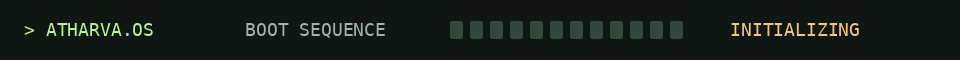
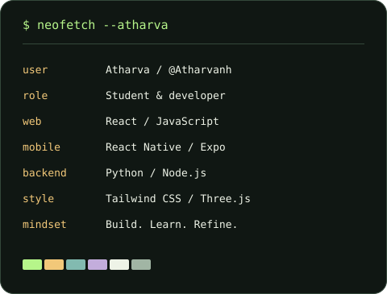

  

<picture>
  <source media="(max-width: 600px)" srcset="./assets/hero-mobile.svg" />
  
</picture>

  <a href="https://atharvanh.me"><strong>↗ ENTER PORTFOLIO</strong></a> &nbsp; / &nbsp;
  <a href="https://linkedin.com/in/atharvaharale"><strong>LINKEDIN</strong></a> &nbsp; / &nbsp;
  <a href="mailto:atharvapc1@gmail.com"><strong>LET'S TALK</strong></a>

### `01 / whoami`

I'm **Atharva**, a student and developer who likes making useful things feel considered. I build web experiences, explore mobile apps, and turn interesting problems into working experiments—from developer intelligence to food-label scanning.

### `02 / ls ~/selected-work`

**[01 → ZeroLabs](https://github.com/Atharvanh/new-zerolabs)** · Developer career intelligence 
Reads public code to build AI-assisted engineering reports and career insights. 
`JavaScript` `Node.js / Express` `Gemini` `Tailwind CSS` `Three.js`

**[02 → WelNest](https://github.com/Atharvanh/cep_project)** · Health & nutrition college project 
Barcode-based food facts, portion logging, nutrition charts, and exportable reports. 
`React Native` `Expo` `TypeScript` `Open Food Facts`

**[03 → CETPredict](https://cetpredict.me)** · MHT-CET college predictor 
Explore personalized college predictions, historical CAP cutoffs, NIRF rankings, and detailed college profiles. 
`Python` `JavaScript` `HTML / CSS` `JSON / Data Parsing`

Selected projects from my public work. ZeroLabs and WelNest link to source; CETPredict opens the live site.

### `03 / git log --every-day`

<picture>
  <source media="(max-width: 600px)" srcset="./assets/activity-mobile.svg" />
  
</picture>

[Explore the full activity history ↗](https://github.com/Atharvanh?tab=overview) · [Refresh workflow](https://github.com/Atharvanh/Atharvanh/actions/workflows/update-profile-art.yml)

---

### `04 / open a connection`

Have an interesting idea, a thoughtful collaboration, or something worth building?

**[atharvanh.me ↗](https://atharvanh.me)** &nbsp; · &nbsp; **[LinkedIn ↗](https://linkedin.com/in/atharvaharale)** &nbsp; · &nbsp; **[atharvapc1@gmail.com ↗](mailto:atharvapc1@gmail.com)**

End of file. Start of a conversation. &nbsp; ▌
